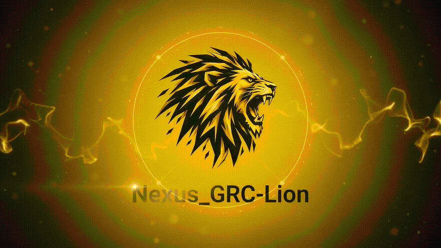
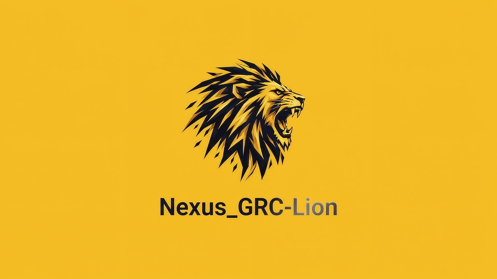
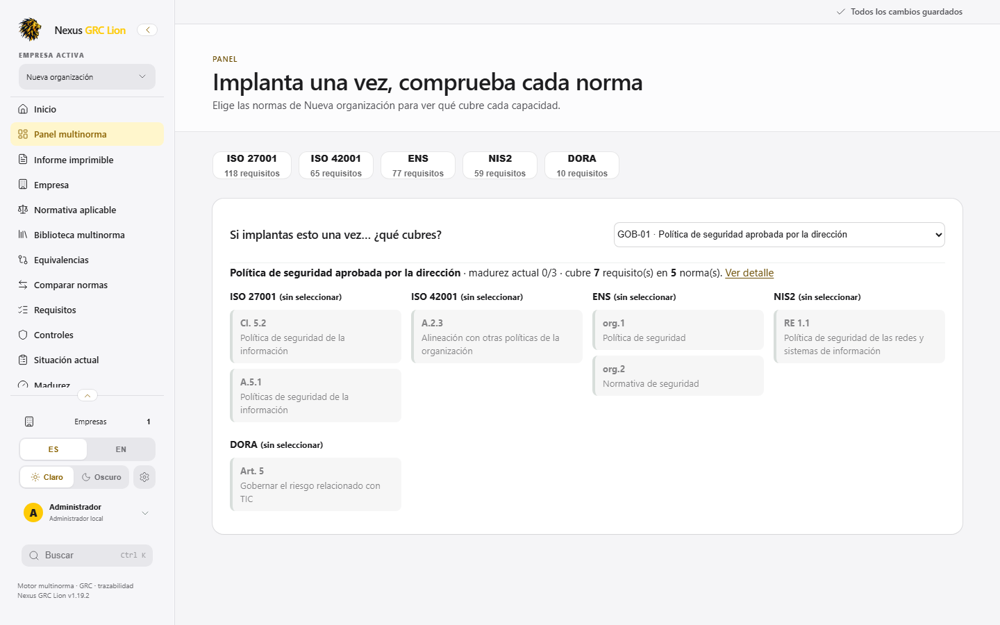
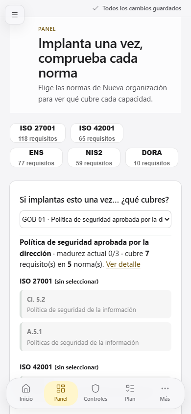

# Nexus GRC Lion

<p align="center">
  
</p>

<p align="center">
  <b>Herramienta local de apoyo GRC multinorma</b><br/>
  Evaluación, madurez, riesgos, evidencias, auditorías, correspondencias y planes de acción.<br/>
  Corre en el navegador · los datos no salen del dispositivo.
</p>

<p align="center">
  
  
  
  
</p>

---

## Intro (vídeo)

> GitHub no reproduce bien un `.mp4` relativo en el README. Aquí va la intro en **GIF** (se ve al instante) y el **vídeo completo** en el repo.

<p align="center">
  <a href="https://github.com/Himardlg/lion-grc-nexus/blob/rama_heindall92/assets/intro.mp4">
    
  </a>
</p>

<p align="center">
  <b><a href="https://github.com/Himardlg/lion-grc-nexus/raw/rama_heindall92/assets/intro.mp4">▶ Ver / descargar el vídeo completo (MP4)</a></b><br/>
  <sub>También en el repo: <code>assets/intro.mp4</code> · ~10 s · marca Lion</sub>
</p>

<p align="center">
  
</p>

---

## Capturas

### Escritorio — panel multinorma

<p align="center">
  
</p>

### Móvil (390 px)

<p align="center">
  
</p>

---

## Quién hace qué

| Persona | GitHub | De qué se encarga |
|--------|--------|-------------------|
| **Yoandy Ramirez Delgado** | [`heindall92`](https://github.com/heindall92) | **Diseño, UX/UI y marca Lion** — tipografía/materiales, acento amarillo, logo y favicon, intro, responsive móvil, shell, iconos Lucide. También **catálogo / sync** derivado de Rosetta Multinorma. |
| **Himardlg** | [`Himardlg`](https://github.com/Himardlg) | **Funcionalidades GRC y producto** — empresas, motor de cobertura/madurez, SoA, riesgos, evidencias, auditorías, planes, export/import, respaldos, buscador e informes. |

### Esta rama (`rama_heindall92`)

Trabajo de **Yoandy / heindall92** para revisión (no mergeado a `main` todavía):

- Marca Nexus GRC Lion (logo, favicon, intro)
- Acento amarillo de producto
- Intro + fundido negro→amarillo en móvil
- UI móvil / shell
- README con intro visible, capturas y roles

**Origen del catálogo:** [Rosetta Multinorma](https://github.com/heindall92/rosetta_multinorma) (GPL-2.0). Ver `LICENSE` y `NOTICE.md`.

---

> **Estado:** candidata a pruebas. No es certificadora ni dictamen jurídico. Valida correspondencias contra la fuente oficial.

## Inicio rápido

```bash
npx --yes serve -l 4192 .
```

Abre `http://localhost:4192/` · o `index.html` / `dist/nexus.html`.

```bash
npm test
npm run build
```

## Funcionalidades

- Empresas y proyectos locales
- Marcos, requisitos, controles y madurez
- Panel multinorma, comparador, matriz y CSV
- Riesgos, evidencias, auditorías y acciones
- Export/import y respaldo completo
- Tema claro/oscuro · ES/EN (menú)

## Privacidad

Sin servidor ni cuenta. Datos en `localStorage`. Exporta respaldos; no guardes secretos en la app.

## Licencia

GNU GPL v2 — `LICENSE`. Historial: [CHANGELOG.md](CHANGELOG.md).
